# 什么是 NeoLinker？

NeoLinker 是一款**免费开源**（Apache-2.0）的桌面配置工具，面向 **CamThink 设备**——NE 系列低功耗 AI 相机与 EK410 墨水屏。它通过蓝牙（BLE）、设备 softAP 或局域网发现设备，带你完成 **连接 → 配置 → 下发 → 回执核对** 的完整配网流程，并在结束时为每台设备生成一份可留存、可导出的纯文本回执。Windows 是主支持平台；macOS 为实验性支持，见[安装与环境](./2-user-guide/1-install-setup.md)。

它是**配套工具而非固件**：把设备置于配置模式，在 NeoLinker 中选中它，剩下的交给向导。界面中英双语，支持亮 / 暗双主题。

## 核心特性

- **环境自检**——启动时逐路检查 BLE 适配器 / WLAN / LAN 的可用性，开工前先确认通道就绪。
- **三路发现**——BLE 广播扫描、softAP SSID 扫描、局域网发现（CT-Disc）；支持机型过滤、分页，以及扫码录入（扫描或上传设备随附的二维码图片）。
- **相位驱动的配置会话**——连接 → 读能力 → 逐模块配置 → 下发 → 结果，一屏一相位；断连自动检测并原位重连，迟到结果幂等丢弃。
- **能力驱动的配置表单**——设备上报自身支持的配置模块（Wi-Fi / 蜂窝 / MQTT / Webhook …），表单按上报生成并预填当前值，不问设备答不出的问题。
- **内嵌管理页**——NE503 的管理页在应用内直接打开，无需浏览器。
- **回执与历史**——每次完成的会话写出按设备的纯文本回执；历史会话可列表、可导出。

## 工作原理

NeoLinker 与设备之间是**一条向导式的配置链路**：桌面端经三路通道之一发现设备并建立会话，读取设备能力后，把本次填写的配置合并为**一次请求整体下发**（任一节校验失败则整单拒绝），设备持久化后返回结果。

```mermaid
flowchart TB
    NL["NeoLinker 桌面端<br/>Windows 10/11 x64 · macOS（实验性）"]

    subgraph CH ["三路发现 / 配置通道"]
        BLE["BLE 广播扫描<br/>CT-Prov/1 over GATT"]
        AP["softAP SSID 扫描<br/>CT-Prov/1 over HTTP"]
        LAN["局域网发现<br/>CT-Disc UDP 组播"]
    end

    subgraph DEV ["CamThink 设备"]
        NE101["NE101<br/>低功耗 AI 相机"]
        NE301["NE301<br/>边缘 AI 相机"]
        NE503["NE503<br/>AI 相机与计算平台"]
        EK410["EK410<br/>墨水屏"]
    end

    SESS["配置会话<br/>连接 → 读能力 → 填写配置 → 整体下发 → 结果"]
    RCT["设备回执<br/>纯文本 · 可导出"]

    NL --> BLE & AP & LAN
    BLE -->|"✅ 主力通道（已实地验证）"| NE101
    AP  -->|"✅"| NE101
    AP  -->|"✅（BLE 计划中）"| NE301
    LAN -->|"✅ 发现 + 内嵌管理页"| NE503
    BLE -->|"🧪 已适配，尚未真机验证"| EK410
    AP  -->|"🧪 已适配，尚未真机验证"| EK410
    NL --> SESS --> RCT

    classDef toolNode fill:#dae8fc,stroke:#6c8ebf,color:#1a3d6b
    classDef chanNode fill:#d5e8d4,stroke:#82b366,color:#1f4d1f
    classDef devNode fill:#f8cecc,stroke:#b85450,color:#6b1a1a
    classDef flowNode fill:#fff2cc,stroke:#d6b656,color:#7d6400
    class NL toolNode
    class BLE,AP,LAN chanNode
    class NE101,NE301,NE503,EK410 devNode
    class SESS,RCT flowNode
```

## 机型支持

| 机型 | BLE（CT-Prov/1） | SoftAP（CT-Prov over HTTP） | LAN（CT-Disc） | 备注 |
| ---- | :---: | :---: | :---: | ---- |
| NE101 | ✅ | ✅ | — | 主目标机型；BLE 链路已真机端到端验证 |
| NE301 | 🚧 | ✅ | — | 暂只走 softAP，BLE 计划中；支持通讯模块配置（Wi-Fi / 蜂窝 / MQTT / Webhook） |
| NE503 | — | — | ✅ | 局域网发现 + 内嵌管理页；最新、真机验证最少的一路 |
| EK410 | 🧪 | 🧪 | — | 墨水屏终端；可配 Wi-Fi 与 MQTT；已适配，尚未用 NeoLinker 真机验证 |

真机测试目前以 NE101 为主；NE301 暂只支持 softAP 配置；NE503 支持最新、真机验证最少的一路。EK410 的 BLE 与 softAP 两路均已适配（对应固件 1.3.10），但还没有用 NeoLinker 做过真机联调；进入配网模式的方式见 [EK410 文档](/docs/epaper-ek410-series/ek410-quick-start)。

## 系统要求与下载

| 项目 | 要求 |
| ---- | ---- |
| 操作系统 | Windows 10/11 x64（主支持平台）；macOS 为实验性支持，详见[安装与环境](./2-user-guide/1-install-setup.md) |
| 运行时 | 仅 Windows 需要 WebView2 Evergreen 运行时（Windows 11 及多数已更新的 Windows 10 自带） |
| 蓝牙 | BLE 通道需要蓝牙适配器 |
| 安装方式 | 免安装——解压即用 |

从 [GitHub Releases](https://github.com/camthink-ai/NeoLinker/releases) 下载最新的 `NeoLinker_v*_windows_x64.zip`，解压后直接运行 `NeoLinker.exe`。

:::note 版本说明
EK410 支持与 macOS 版本暂未随正式版本发布：已发布的 v0.3.0 及更早版本仅支持 Windows，机型为 NE101 / NE301 / NE503。
:::

:::tip 五分钟上手
下载解压 → 环境自检 → 扫描发现 → 连接 → 配 Wi-Fi → 交付核对回执，完整走一遍见 [快速上手](./1-quick-start.md)。
:::

## 相关协议规范

NeoLinker 实现的线上协议在 [NeoLinker 仓库](https://github.com/camthink-ai/NeoLinker)中以英文规范维护：

- [CT-Prov/1 通讯配置协议](https://github.com/camthink-ai/NeoLinker/blob/main/docs/ct-prov-protocol.md)——BLE GATT 与 softAP HTTP 两种绑定
- [CT-Prov/1 配置节定义](https://github.com/camthink-ai/NeoLinker/blob/main/docs/ct-config-schema.md)——各配置节的字段定义
- [CT-Disc 设备发现与管理协议](https://github.com/camthink-ai/NeoLinker/blob/main/docs/ct-disc-protocol.md)——UDP 组播 + MQTT

## 许可

Apache-2.0，免费开源。Copyright 2026 CamThink Team.
