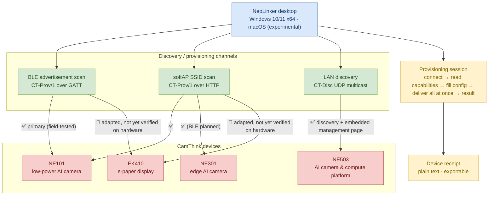

# What is NeoLinker?

NeoLinker is a **free and open-source** (Apache-2.0) desktop tool for **CamThink devices** — NE-series low-power AI cameras and the EK410 e-paper display. It discovers devices over Bluetooth LE, the device's own softAP, or the local network, walks you through **connect → configure → deliver → receipt check**, and finishes with a plain-text receipt per device that you can keep or export. Windows is the primary supported platform; macOS is experimental — see [Install & Setup](./2-user-guide/1-install-setup.md).

It is a **companion tool, not firmware**: put a device into configuration mode, pick it up in NeoLinker, and let the wizard do the rest. The UI is bilingual (English / 中文) with light and dark themes.

## Key Features

- **Environment self-check** — on launch the app checks each transport (BLE adapter / WLAN / LAN) so you know every channel's readiness before you start.
- **Multi-channel discovery** — BLE advertisement scan, softAP SSID scan, and LAN discovery (CT-Disc), with model filtering, pagination, and QR-code entry (scan or upload the code printed with the device).
- **Phase-driven provisioning** — connect → read capabilities → configure per module → deliver → result, one screen per phase; link-lost is detected automatically with in-place reconnect, and late results are dropped idempotently.
- **Capability-driven forms** — the device reports the config modules it supports (Wi-Fi / cellular / MQTT / webhook, …); forms are built from that report and prefilled with current values — the app never asks a device something it cannot answer.
- **Embedded management page** — NE503's management page opens inside the app, no browser needed.
- **Receipts & history** — every completed session writes a plain-text receipt per device; past sessions are listed and exportable.

## How It Works

Between NeoLinker and the device there is **one wizard-style provisioning link**: the desktop discovers the device over one of three channels, opens a session, reads capabilities, then delivers all filled configuration in one atomic request (any validation failure rejects the whole request); the device persists it and reports back.

## Device Support

| Device | BLE (CT-Prov/1) | SoftAP (CT-Prov over HTTP) | LAN (CT-Disc) | Notes |
| ------ | :---: | :---: | :---: | ----- |
| NE101 | ✅ | ✅ | — | Primary target; BLE leg field-tested end to end |
| NE301 | 🚧 | ✅ | — | SoftAP first, BLE planned; comm-module config (Wi-Fi / cellular / MQTT / webhook) |
| NE503 | — | — | ✅ | LAN discovery + embedded management page; newest, least field-tested leg |
| EK410 | 🧪 | 🧪 | — | E-paper display terminal; Wi-Fi and MQTT configuration; adapted, not yet verified with NeoLinker on real hardware |

Field testing so far has focused on NE101. NE301 currently provisions over softAP only; NE503 support is the newest and least field-tested. Both EK410 channels (BLE and softAP) are adapted — for firmware 1.3.10 — but have not yet been tried with NeoLinker on real hardware; how to put an EK410 into provisioning mode is covered in the [EK410 documentation](/docs/epaper-ek410-series/ek410-quick-start).

## Requirements & Download

| Item | Requirement |
| ---- | ---- |
| OS | Windows 10/11 x64 (primary supported platform); macOS is experimental — see [Install & Setup](./2-user-guide/1-install-setup.md) |
| Runtime | WebView2 Evergreen, Windows only (preinstalled on Windows 11 and most updated Windows 10) |
| Bluetooth | A Bluetooth adapter is required for the BLE channel |
| Install | None — unzip and run |

Grab the latest `NeoLinker_v*_windows_x64.zip` from [GitHub Releases](https://github.com/camthink-ai/NeoLinker/releases), unzip, and run `NeoLinker.exe`.

:::note Version note
EK410 support and the macOS build have not shipped in an official release yet: v0.3.0 and earlier are Windows-only and support NE101 / NE301 / NE503 only.
:::

:::tip Five minutes to first receipt
Download & unzip → self-check → scan → connect → configure Wi-Fi → deliver and check the receipt — see [Quick Start](./1-quick-start.md).
:::

## Protocol References

The wire protocols NeoLinker implements are maintained (in English) in the [NeoLinker repository](https://github.com/camthink-ai/NeoLinker):

- [CT-Prov/1 — Communication Provisioning Protocol](https://github.com/camthink-ai/NeoLinker/blob/main/docs/ct-prov-protocol.md) (BLE GATT + softAP HTTP bindings)
- [CT-Prov/1 — Configuration Schema](https://github.com/camthink-ai/NeoLinker/blob/main/docs/ct-config-schema.md) (fields of every config section)
- [CT-Disc — Device Discovery & Management Protocol](https://github.com/camthink-ai/NeoLinker/blob/main/docs/ct-disc-protocol.md) (UDP multicast + MQTT)

## License

Apache-2.0, free and open source. Copyright 2026 CamThink Team.
