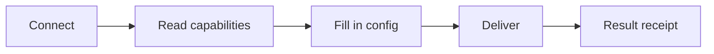

# Provision a Device

Selecting a device in the list starts a **phase-driven provisioning session**:

One screen per phase. If the link drops unexpectedly, the app detects it and **reconnects in place** — the session resumes where it left off, and late duplicate results are dropped idempotently.

## 1. Connect and pair

- **BLE channel**: the link is encrypted. Confirm the Windows pairing prompt when it appears — the bond it creates is the basis of link-layer encryption;
- **softAP channel**: the app joins the device hotspot itself (hotspots are named `<MODEL>_<MAC suffix>`, e.g. `NE101-P_BBC6DC` or `EK410_A1B2C3`; the EK410 hotspot is password-protected and the app handles it);
- **LAN channel (NE503)**: same subnet, direct connection.

Once connected, the app first reads **device info** (model, serial number, …), then the **capability report**.

## 2. Capability readout

The device reports which config modules it supports, with the fields and constraints of each. The config forms are generated entirely from this report — **modules the device does not support never appear, and supported modules come prefilled with current values**, so you only change what you want to change.

## 3. Config-section forms

CT-Prov/1 defines seven config sections. Which ones appear depends on the device model and its comm modules:

| Section | Purpose | Typical models |
| ------ | ------ | ------ |
| `wifi` | Wi-Fi access: SSID, password (can trigger a device-side scan to pick a network) | NE101 / NE301 / EK410 |
| `cellular` | Cellular (CAT1) dial-up: APN, etc. | NE101 / NE301 |
| `halow` | Wi-Fi HaLow low-power long-range access | module-dependent |
| `ethernet` | Ethernet / PoE: nothing to configure — plug and play (DHCP), read-only display | model-dependent |
| `comm` | Network selector: which uplink to prefer | NE301 only (NE101 auto-probes in firmware; the section never appears) |
| `mqtt` | MQTT service: broker address, port, topics, etc. | NE101 / NE301 / EK410 |
| `webhook` | Webhook push: URL, events, etc. | NE101 / NE301 |

Common form behavior:

- **Password fields** have a show/hide toggle — avoid typos on the production line;
- **Payload preview** expands to show the exact JSON that will be delivered;
- Cancelling keeps the **draft**, so you can come back and continue.

## 4. Deliver

Click **Deliver** and the app sends all filled sections in **one atomic request** — if any section fails validation the whole request is rejected and nothing is written. Delivery semantics worth knowing:

- **Whole-section overwrite** — each section is overwritten from this session's form; it is idempotent: delivering the same content twice has the same result;
- **Success means persisted** — a success response means the configuration is in non-volatile storage and survives reboot;
- **No connectivity verification** — the tool does not confirm the device can actually reach the Wi-Fi / broker; runtime outcomes are surfaced by device logs, the device's local page, or the platform side.

### EK410 differences

EK410 firmware (1.3.10) differs from the above in two ways:

- **Over softAP it tries to connect before saving**: the device first spends about 20 s trying to join the target Wi-Fi and writes to storage only on success. With a wrong Wi-Fi password the delivery fails right away with `STORAGE_FAILED` and the detail `wifi associate failed` — treat that as a wrong password, not a storage fault. Over BLE the section is saved first and the connection is attempted best-effort.
- **Wi-Fi and MQTT are not saved atomically**: if Wi-Fi succeeds and MQTT fails in the same delivery, the Wi-Fi configuration has already been written to the device.

In addition, after a successful Wi-Fi delivery over BLE the EK410 closes its provisioning window by itself about 1.2 s later — that is normal.

These behaviours were read from the EK410 firmware source and have not been verified with NeoLinker on real hardware.

### Common error codes

| Code | Meaning | What to do |
| ------ | ------ | ------ |
| `INVALID_ARGUMENT` | Invalid argument type / range / combination | Fix per the form's validation hints and retry |
| `SECTION_NOT_SUPPORTED` | Section unsupported or not configurable | The model has no such module — drop the section and deliver again |
| `FIELD_NOT_SUPPORTED` | Request contains a field outside the capability report | Refresh capabilities and use the new form |
| `BUSY` | Device serving another connection or scan | Wait and retry; make sure no other host is configuring it |
| `STORAGE_FAILED` | Persisting the configuration failed; over the EK410 softAP channel this is usually a failed Wi-Fi association (e.g. a wrong password) | Check the error detail: for `wifi associate failed`, check the Wi-Fi password; otherwise retry, and if it persists check device storage health |
| `INVALID_MESSAGE` / `UNSUPPORTED_VERSION` / `UNSUPPORTED_OPERATION` / `INTERNAL_ERROR` | Message / version / operation mismatch, or internal error | Upgrade device firmware and the app, then retry |

## 5. Link lost and reconnect

If the link drops mid-session (device sleep, distance, hotspot switching):

- The app marks **link lost** and attempts an **in-place reconnect** without discarding the filled form;
- After reconnecting, the session resumes from where it stopped;
- Results arriving after the session has ended are dropped idempotently — receipts stay clean.

---

On success the app moves to the result page — see [Receipts & History](./4-receipts-history.md).
